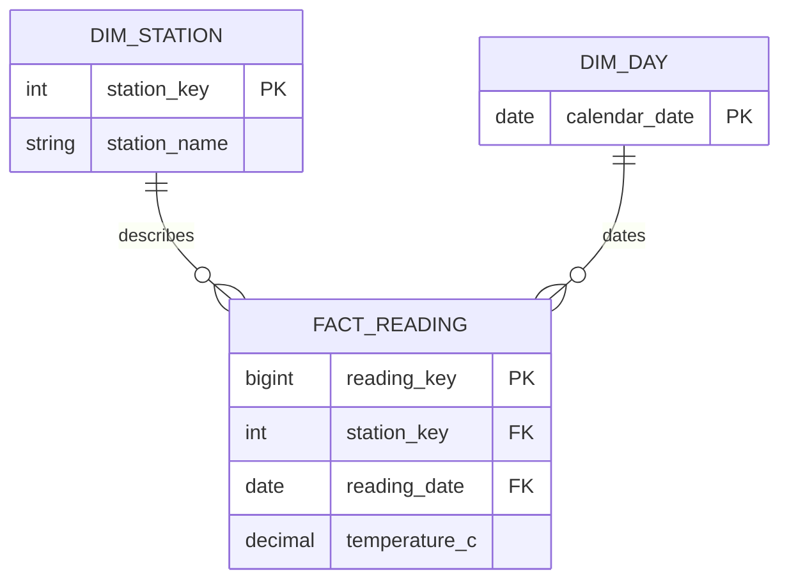

> Refreshed workflow: write DDL in schema.sql, run it on weather_day09, then run the provided fixture.sql once. The fixture load is now separate from your table definitions. Follow guide.md for this order.

# Day 12 tutorial — From observations to an analytical model

Read one section, try its example, then complete the matching task in model.md or schema.sql. The SELECT examples can run in pgAdmin on weather_day09. The table-definition example belongs in your saved schema.sql; execute the finished build only after all three TODOs are complete.

## 1. What data modeling does

A data model defines the meaning of rows, columns, keys, and relationships. SQL syntax lets you create tables, but syntax alone cannot tell you whether a table represents the right thing.

Suppose your pipeline receives this observation:

```text
city = Hanoi
observed_at = 2026-09-18 09:00:00+07
temperature_c = 30.0
humidity_pct = 80
```

Before storing it, decide:

1. Is this one observation, or a summary of a day?
2. Which columns describe the city, and which describe this measurement?
3. What distinguishes this observation from another one?
4. Which values should reports group by?

Today your model stores each observation and connects it to a city and a calendar date. Later, an analyst can choose the grouping needed by a report.

### OLTP and OLAP

**OLTP** means Online Transaction Processing. Think of individual operational actions: recording an order, updating a customer, or inserting an observation.

**OLAP** means Online Analytical Processing. Think of comparisons across data: average recorded temperature per city/date or observation counts by month.

| Operational-style task | Analytical task |
|---|---|
| Insert one valid weather observation | Compare recorded temperatures across cities |
| Find one observation by city and instant | Group observations by local date |
| Maintain one city's configuration | Find cities with missing observations |

Your public tables are a small operational-style source for this lab. The new model is a weather **mart**: an analytical model for one subject. PostgreSQL can support both kinds of work; these terms describe workloads and design goals, not separate products you must install.

Read: [Microsoft: OLTP and analytical workloads](https://learn.microsoft.com/en-us/azure/architecture/data-guide/relational-data/online-transaction-processing), introduction and the discussion of OLTP versus analytics.

With eight rows, both designs can answer our questions. This exercise teaches explicit modeling choices. It does not demonstrate a performance advantage at this size.

**Your turn:** write model.md section 1.

## 2. A database, a schema, and a table

In PostgreSQL, a **schema** is a namespace inside a database. It groups objects under a name. Our final structure will be:

```text
PostgreSQL server
└── weather_day09                    database
    ├── public                      existing schema
    │   ├── cities
    │   └── weather_observations
    └── day12_mart                   new schema
        ├── dim_city
        ├── dim_date
        └── fact_weather
```

`public.cities` means the cities table in the public schema. `day12_mart.dim_city` names a different table in the same connected database.

The phrase **star schema** refers to a modeling pattern. The PostgreSQL command **CREATE SCHEMA** creates a namespace. Creating a namespace alone does not create a star-shaped model.

Our build uses:

```sql
CREATE SCHEMA day12_mart;
```

Write that line near the beginning of schema.sql, before the three table definitions. Execute the complete DDL in one transaction.

Read: [PostgreSQL schemas](https://www.postgresql.org/docs/18/ddl-schemas.html), introduction and Creating a Schema.

## 3. Grain: what does one row represent?

**Grain** is the precise meaning of a single fact row. Decide it before selecting dimensions and measurements, and keep it consistent throughout the table. [Kimball: grain](https://www.kimballgroup.com/data-warehouse-business-intelligence-resources/kimball-techniques/dimensional-modeling-techniques/grain/)

For this single-provider fixture:

> One fact row represents one weather observation for one city at one observed instant.

That is more precise than "one row of weather" or "one city per day."

Run:

```sql
SELECT c.city_name, o.observed_at, o.temperature_c
FROM public.weather_observations AS o
INNER JOIN public.cities AS c ON c.city_id = o.city_id
WHERE c.city_name = 'Hanoi'
  AND (o.observed_at AT TIME ZONE c.timezone_name)::date = DATE '2026-09-18'
ORDER BY o.observed_at;
```

You should see **two rows**: 09:00 at 30.0 C and 12:00 at 32.0 C.

Both observations belong in the fact. Adding observation_date does not merge them. A later GROUP BY can produce one daily report row with count 2 and average 31.0 C.

### Stored grain versus result grain

| Object | Grain | Rows in our fixture |
|---|---|---:|
| fact_weather | One city at one observed instant | 8 |
| A city/date report over facts | One city on one observed local date | 5 |
| A city report including Hue | One city | 4 |

An observation and a daily average describe different things. Do not insert a daily-summary row beside the original observations in fact_weather: it would overlap the detail and distort later summaries.

**Try:** change the Hanoi filter to Ho Chi Minh City. Predict the row count before executing.

**Your turn:** fill model.md section 2.

## 4. Facts describe measurements; dimensions describe context

The model has two dimensions around one central fact table.

| Table | Role | Examples of its contents |
|---|---|---|
| dim_city | Describes the place | Name, timezone, source-to-mart ID mapping |
| dim_date | Describes a calendar date | Date, year, month, ISO weekday |
| fact_weather | Records the measurement event | City/date references, observed instant, temperature, humidity |

Dimension attributes give reports labels and grouping choices. Facts retain measurements and references to those labels. [Microsoft: star schema overview](https://learn.microsoft.com/en-us/power-bi/guidance/star-schema#star-schema-overview)

Not every numeric column is a measurement. city_key is numeric, but averaging city IDs has no useful meaning. calendar_year is numeric, but it describes a date rather than a measured temperature.

### Why have dim_date when observed_at already contains a date?

The dimension supplies a reusable description of each calendar date. It supports grouping by weekday, month, or year through one relationship. For this small exercise its two rows are derived from observed dates; a fuller warehouse could populate an entire calendar.

The fact keeps observed_at to distinguish the multiple observations on a date. observation_date connects each observation to its local calendar date.

### What about source and requested_at?

These are provenance metadata: where a record came from and when it was requested. They are not temperature measurements.

To keep the lab small, source stays as text in the fact. If later requirements need provider descriptions or multiple providers, revisit the model. A provider dimension and a grain that includes provider might become useful.

The city dimension stores one current city description. It does not preserve versions of a city's name or timezone. Historical dimension changes are a later topic.

**Your turn:** start model.md's dictionary and assumptions.

## 5. Keys, relationships, and an ERD

### Source keys and surrogate keys

The source identifies a city using public.cities.city_id. The mart creates its own **surrogate key**, dim_city.city_key, and keeps the original ID as source_city_id for mapping.

Example mapping, using hypothetical IDs:

| source_city_id | city_key | city_name |
|---:|---:|---|
| 8 | 100 | Example City |

When a source observation has city_id 8, the loader finds source_city_id 8 and stores city_key 100 in the fact. It must not store 8 merely because both columns are integers.

Read: [Microsoft: surrogate keys](https://learn.microsoft.com/en-us/power-bi/guidance/star-schema#surrogate-keys).

### Primary keys, foreign keys, and duplicate observations

- **PRIMARY KEY** identifies a stored row.
- **FOREIGN KEY** requires a referenced dimension row to exist.
- **UNIQUE (city_key, observed_at)** prevents two fact rows from describing the same city/instant in this single-provider exercise.

A generated observation_key can assign two different IDs to the same observation if the city/instant pair is not also unique. Generated IDs do not determine the business grain.

Use calendar_date directly as dim_date's primary key. There is no need to invent another key for this exercise.

### Read the cardinality

Each fact must reference **exactly one city** and **exactly one date**.

Each city or date can be referenced by **zero or many facts**. Hue demonstrates why a city can exist without measurements. The fact's foreign keys are NOT NULL; missing context is not allowed by this lab's design.

An **ERD** (Entity-Relationship Diagram) shows tables and their relationships. Here is the notation using a different, simplified station-reading model:



Read `||--o{` from left to right as "one dimension row relates to zero or many fact rows." PK and FK mark key columns. Your weather diagram should use the actual weather columns and show its composite UNIQUE pair as a note.

If Mermaid is unfamiliar, this text style is sufficient:

```text
DIM_STATION                         FACT_READING
station_key [PK]  1 -------- 0..many  station_key [FK]
station_name                        reading_key [PK]
                                    reading_date [FK]
                                    temperature_c

DIM_DAY
calendar_date [PK] 1 ------- 0..many  FACT_READING.reading_date
```

You do not need to install a diagramming tool. After building your tables, pgAdmin's ERD can show their foreign-key links. Follow guide.md section 5.

**Your turn:** complete model.md section 3.

## 6. Translate your model into CREATE TABLE

You already used table definitions in Day 8. Today the new part is choosing their analytical meaning.

Here is the complete **date-dimension** example. Retype or adapt it into **schema.sql TODO 2**. Do not execute it separately; it needs the schema created by the full build.

```sql
CREATE TABLE day12_mart.dim_date (
    calendar_date DATE PRIMARY KEY,
    calendar_year INTEGER NOT NULL,
    calendar_month SMALLINT NOT NULL
        CHECK (calendar_month BETWEEN 1 AND 12),
    iso_weekday SMALLINT NOT NULL
        CHECK (iso_weekday BETWEEN 1 AND 7)
);
```

Read it line by line:

1. CREATE TABLE names the schema and new table.
2. Parentheses contain its column definitions and table constraints.
3. Each column has a name, type, and any constraints.
4. Commas separate definitions; there is no comma before the closing parenthesis.
5. The statement ends with a semicolon.

Use these clauses when writing the other two tables:

```sql
-- A dimension's generated key:
city_key INTEGER GENERATED ALWAYS AS IDENTITY PRIMARY KEY

-- A fact's required reference:
city_key INTEGER NOT NULL REFERENCES day12_mart.dim_city (city_key)

-- A TABLE constraint: put it after the column definitions.
UNIQUE (city_key, observed_at)
```

These three fragments belong in different places described in schema.sql; they are not standalone statements.

NUMERIC(4,1) has four total digits, one after the decimal point. It suits the exercise's -50 to 60 C range. SMALLINT suits a whole-number humidity percentage. NOT NULL requires a value; CHECK validates a condition; UNIQUE protects an identifier or column combination.

An identity column generates values when the INSERT omits it. PRIMARY KEY separately enforces its uniqueness. [PostgreSQL identity columns](https://www.postgresql.org/docs/18/ddl-identity-columns.html)

A date foreign key proves that the date exists in dim_date. It does not prove that the date agrees with observed_at in the city's timezone. A5 checks that extra relationship.

Read: [PostgreSQL constraints](https://www.postgresql.org/docs/18/ddl-constraints.html), especially Unique Constraints and Foreign Keys. Use help.md for exact fragments and common errors.

**Your turn:** finish schema.sql TODOs 1–3 and model.md's dictionary.

## 7. Understand the provided load

The workflow has two phases:

1. Your schema.sql: BEGIN; create the schema, dimensions and fact; COMMIT.
2. The provided fixture.sql: BEGIN; check the source and empty targets; insert dimensions, then facts; COMMIT.

If DDL fails, ROLLBACK in the same connection clears its uncommitted changes. If the later load fails, ROLLBACK clears that load but the earlier committed tables remain. Fix the issue before retrying; do not recreate existing tables blindly.

The provided fixture guard checks the database, source counts/sum and empty targets. It is support code, not a PL/pgSQL assignment. [Transactions](https://www.postgresql.org/docs/18/tutorial-transactions.html)

### INSERT ... SELECT

The load reads existing rows rather than typing eight observations again:

```sql
INSERT INTO day12_mart.dim_city
    (source_city_id, city_name, timezone_name)
SELECT city_id, city_name, timezone_name
FROM public.cities
ORDER BY city_name;
```

Each selected source column supplies the corresponding named target column **by position**. The generated city_key is omitted, so PostgreSQL assigns it. Copying all cities preserves Hue even though it has no observations.

The fact load looks up city_key using source_city_id. Both dimensions must exist and be populated before their referenced values can be inserted into the fact.

### Choose the correct calendar date

Try this boundary example:

```sql
SELECT
    DATE '2026-09-17' AS utc_calendar_date,
    (TIMESTAMPTZ '2026-09-17 18:30:00+00'
        AT TIME ZONE 'Asia/Ho_Chi_Minh')::date AS city_calendar_date;
```

The local date is **2026-09-18**: 18:30 UTC is 01:30 the next day in this timezone.

The real load uses:

```sql
(o.observed_at AT TIME ZONE c.timezone_name)::date
```

AT TIME ZONE converts the stored instant to the city's local clock representation; ::date extracts its calendar date. A plain observed_at::date depends on the session timezone and can give the wrong city date near midnight.

The date load uses DISTINCT because many observations can have the same calendar date. EXTRACT reads year, month, and ISO weekday. ISO weekday is Monday 1 through Sunday 7.

Try:

```sql
SELECT
    EXTRACT(YEAR FROM DATE '2026-09-18') AS calendar_year,
    EXTRACT(MONTH FROM DATE '2026-09-18') AS calendar_month,
    EXTRACT(ISODOW FROM DATE '2026-09-18') AS iso_weekday;
```

Expected: **2026, 9, 5**. [PostgreSQL date/time functions](https://www.postgresql.org/docs/18/functions-datetime.html)

**Your turn:** execute schema.sql once, then fixture.sql once, then checks.sql A1–A6.

## 8. Query the star

After the build, run this worked example:

```sql
SELECT
    d.calendar_date,
    d.iso_weekday,
    COUNT(*) AS observation_count,
    ROUND(AVG(f.temperature_c), 2) AS avg_temperature_c
FROM day12_mart.fact_weather AS f
INNER JOIN day12_mart.dim_date AS d
    ON d.calendar_date = f.observation_date
GROUP BY d.calendar_date, d.iso_weekday
ORDER BY d.calendar_date;
```

Expected:

| calendar_date | iso_weekday | observation_count | avg_temperature_c |
|---|---:|---:|---:|
| 2026-09-18 | 5 | 6 | 31.33 |
| 2026-09-19 | 6 | 2 | 31.50 |

The date dimension supplies grouping attributes. The fact supplies measurements. This result has one row per observed calendar date, while the underlying fact still has eight rows.

To add a city label, join dim_city.city_key to fact_weather.city_key. Do not join city_key to observation_key or assume it equals source_city_id.

For a report that must include cities without observations, start from dim_city and LEFT JOIN the fact. COUNT(f.observation_key) counts only actual observations; COUNT(*) also counts the unmatched city's placeholder row. Leave the average NULL when no measurements exist.

**Try:** filter the worked example to iso_weekday = 5 and predict the count.

**Your turn:** complete queries.sql Q1–Q3. Compare values, column names, and ordering with expected.md.

## 9. Choose valid aggregations

The data type being numeric does not mean SUM is a useful metric.

Adding Hanoi's 30, 32, and 31 gives 93, but **93 C is not Hanoi's combined temperature**. For this exercise, report the average, minimum, maximum, and observation count.

Temperature is non-additive for our reporting purpose: it does not have a meaningful temperature total across cities or observation times. Observation counts can be added over disjoint groups. [Kimball: additive and non-additive facts](https://www.kimballgroup.com/data-warehouse-business-intelligence-resources/kimball-techniques/dimensional-modeling-techniques/additive-semi-additive-non-additive-fact/)

### Avoid averaging daily averages without their counts

Ho Chi Minh City's first day has two observations with average 33.5 C. Its second day has one observation at 32.0 C.

```sql
WITH daily_summary (observation_count, daily_avg_c) AS (
    VALUES (2, 33.5), (1, 32.0)
)
SELECT
    ROUND(AVG(daily_avg_c), 2) AS equal_day_average_c,
    ROUND(
        SUM(observation_count * daily_avg_c) / SUM(observation_count),
        2
    ) AS all_observations_average_c
FROM daily_summary;
```

Expected: **32.75** and **33.00**. Equal weighting of days answers a different question from equal weighting of observations. When combining groups to recover the observation average, retain their counts and use unrounded component averages.

Prefer AVG over the atomic facts when they are available. These examples weight each observation equally; they do not calculate an average weighted by the elapsed time between readings.

### Keep missing data separate from zero

Hue belongs in dim_city because it is a city the source knows about. It has no facts. Inserting a fake 0 C observation would claim a measurement happened and distort counts and averages.

This also connects to Day 11: LAG's missing predecessor stays NULL, and a ROWS frame counts observations rather than days.

**Your turn:** answer model.md's six reflections. Complete its assumptions and compare your saved model with the actual tables.

## Optional reading

Spend at most 20 minutes on these today:

- [Kimball grain](https://www.kimballgroup.com/data-warehouse-business-intelligence-resources/kimball-techniques/dimensional-modeling-techniques/grain/): read the short definition.
- [Microsoft star schema](https://learn.microsoft.com/en-us/power-bi/guidance/star-schema): read Star schema overview and Surrogate keys.
- [pgAdmin ERD Tool](https://www.pgadmin.org/docs/pgadmin4/latest/erd_tool.html): inspect the introduction and diagram-generation options.

Leave slowly changing dimensions, snowflake models, and large warehouse tuning for later. Today's deliverable is your own understandable three-table model.
