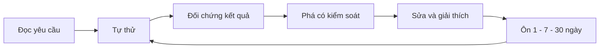

# DEcourse

> [!info] Học để xây và vận hành sản phẩm dữ liệu
> Bắt đầu từ [[Study Map]], xem [[Tien do va bang chung]], tra ví dụ theo chủ đề. Một công cụ chỉ được tính là đã học khi bạn tự làm, giải thích và kiểm chứng được.

## Điều hướng

- [[Study Map]] · [[Lich on tap]] · [[Tien do va bang chung]] · [[Hoc va lam viec voi AI]]
- Python: [[Python co ban va Collections]], [[Functions va Error Handling]], [[Files CSV JSON Parquet]], [[Datetime Decimal va Timezone]], [[DataFrames pandas Polars]], [[Python Environment va Packaging]]
- SQL: [[SELECT NULL va CASE]], [[JOIN Grain va Fanout]], [[Aggregation va Window Functions]], [[CTE Dedup va Incremental SQL]], [[Transactions Index va EXPLAIN]]
- Công cụ: [[Git Branch PR va Review]], [[Shell Linux va PowerShell]]
- Core: [[Data Modeling va SCD2]], [[Ingestion Contract va Idempotency]], [[API Retry Pagination va Replay]], [[Incremental CDC Backfill]], [[Testing Logging va CI]]
- Stack: [[dbt Models Tests va Incremental]], [[Docker PostgreSQL va Serving]], [[Airflow Interval va Backfill]], [[BI Metrics va Data Product]]
- Production: [[Observability va Recovery]], [[Security va Governance]], [[Delivery va Reproducibility]], [[Performance va Storage]]
- Cloud: [[GCP BigQuery Terraform va Cost]]
- Chuyên sâu: [[Spark Partitions Shuffle va Skew]], [[Kafka Offsets Replay va Ordering]], [[ML Features va Point in Time]], [[LLM Cache Evaluation va Guardrails]], [[RAG Retrieval va Evaluation]]
- Dự án: [[Olist Product Brief]], [[Failure Drills]], [[Du an thu hai]], [[Interview va Portfolio]]
- Mẫu: [[Mau ghi chu]], [[Nhat ky hoc]], [[Incident Report]], [[Architecture Decision Record]]

## Vòng học

> [!tip] Tra nhanh khi đang code
> Gõ `Ctrl+O`, tìm JOIN, Window, Retry, CDC hoặc Backfill. Sau khi xem, đóng note và viết lại ví dụ với dữ liệu khác.
