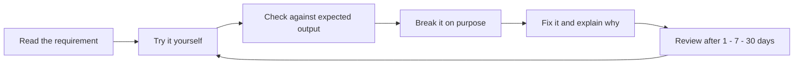

# DEcourse

> [!info] Learn to build and operate data products
> Start with [[Roadmap]], track yourself in [[Progress and Evidence]], and look up theory by topic. A tool only counts as learned when you can build with it, explain it and verify the result yourself.

## How this vault is organised

- **Module guides** (`Module NN - …`): the weekly plan for each module — videos, reading, practice, project tasks and a "done when" checklist.
- **Theory notes** (all other notes in the topic folders): full lessons. Each one explains the concepts from first principles, gives runnable examples with expected output, shows how it applies to the Olist project, lists common mistakes, and ends with exercises and review questions (answers are folded — click to reveal).
- **Labs**: the exercises you code live in the separate code repo under `labs/`. [[Labs Guide]] explains each lab; this vault holds the instructions, the repo holds only code and tests.

## Navigation

- Start: [[Roadmap]] · [[Progress and Evidence]] · [[Review Schedule]] · [[Learning with AI]] · [[Labs Guide]]
- Python: [[Module 01 - Python]], [[Module 04 - DataFrames]] · [[Python Basics and Collections]], [[Functions and Error Handling]], [[Files CSV JSON and Parquet]], [[Datetime Decimal and Timezones]], [[DataFrames pandas and Polars]], [[Python Environments and Packaging]]
- SQL: [[Module 03 - SQL]] · [[SELECT NULL and CASE]], [[JOIN Grain and Fan-out]], [[Aggregation and Window Functions]], [[CTE Dedup and Incremental SQL]], [[Transactions Indexes and EXPLAIN]]
- Tools: [[Module 02 - Git and Linux]] · [[Git Branches PRs and Review]], [[Shell Linux and PowerShell]]
- Core DE: [[Module 05 - Data Modeling]], [[Module 06 - Ingestion and Quality]], [[Module 07 - APIs]], [[Module 08 - Testing and CI]], [[Module 19 - Incremental and CDC]] · [[Data Modeling and SCD2]], [[Ingestion Contracts and Idempotency]], [[API Retry Pagination and Replay]], [[Incremental CDC and Backfill]], [[Testing Logging and CI]]
- Modern stack: [[Module 09 - dbt]], [[Module 10 - Docker Postgres and BI]], [[Module 11 - Airflow]] · [[dbt Models Tests and Incremental]], [[Docker PostgreSQL and Serving]], [[Airflow Intervals and Backfill]], [[BI Metrics and Data Products]]
- Production: [[Module 20 - Observability and Recovery]], [[Module 21 - Security and Delivery]] · [[Observability and Recovery]], [[Security and Governance]], [[Delivery and Reproducibility]], [[Performance and Storage]]
- Cloud: [[Module 14 - Cloud and Terraform]] · [[GCP BigQuery Terraform and Cost]]
- Specializations: [[Module 12 - Spark]], [[Module 13 - Kafka]], [[Module 15 - ML]], [[Module 16 - LLM]] · [[Spark Partitions Shuffle and Skew]], [[Kafka Offsets Replay and Ordering]], [[ML Features and Point-in-Time]], [[LLM Caching Evaluation and Guardrails]], [[RAG Retrieval and Evaluation]]
- Projects: [[Module 17 - Capstone]], [[Module 18 - Portfolio and Interviews]], [[Module 22 - Independent Project]] · [[Olist Product Brief]], [[Failure Drills]], [[Second Project]], [[Interviews and Portfolio]]
- Templates: [[Note Template]], [[Study Log]], [[Incident Report]], [[Architecture Decision Record]]

## The learning loop

## How to read a theory note

1. Read **Learning goals** and try to answer the review questions *before* reading — this tells you what you do not know yet.
2. Work through the concepts, running every `runnable` example yourself (copy it into a Python/DuckDB session) and predicting the output before you look.
3. Do the exercises without opening the folded solutions. Then compare.
4. Close the note and write the key example again from memory with different data.

> [!tip] Quick lookup while coding
> Press `Ctrl+O` and search for JOIN, Window, Retry, CDC or Backfill. After reading, close the note and rewrite the example with your own data.
