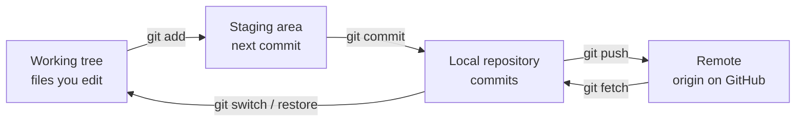

# Git, Branches, PRs and Review

> [!info] Learning goals
> After this note you can: explain Git's model (working tree, staging area, commits, branches, remotes); make small, well-described commits; branch, merge and rebase; resolve conflicts; undo safely with `restore`, `revert` and `reset`; open a useful pull request; and review someone else's change for correctness, not just style.

## 1. What Git is for

Git records the **history of your code** as a chain of snapshots (commits), lets several people work in parallel on branches, and makes every change reviewable. It is not a backup system for data: never commit raw datasets, warehouses or secrets. Data belongs in storage with its own versioning; Git holds the code and configuration that produce it.

## 2. The mental model



- A **commit** is a snapshot of the whole project plus metadata (author, message, parent commit). Its id is a hash of its content, so history cannot be changed silently.
- A **branch** is just a movable pointer to a commit. `HEAD` points to the branch you are on.
- A **remote** (`origin`) is another copy of the repository; `origin/main` is your local record of where `main` was on the remote at your last fetch.

File states: *untracked* (Git ignores it until you add it), *modified* (changed since the last commit), *staged* (will go into the next commit).

## 3. Everyday workflow

Use a separate practice repository while you learn.

```bash
git status --short                 # what changed?
git switch -c lab/ingest-keys      # new branch from the current commit
git diff                           # unstaged changes
git add labs/06-ingest             # stage a folder (or: git add -p for chunk-by-chunk)
git diff --cached                  # exactly what will be committed
git commit -m "feat(lab): validate order keys before publish"
git push -u origin lab/ingest-keys # publish the branch and track it
```

Before every commit check the staged files for secrets, datasets and temporary files. `git add -p` lets you stage only the hunks that belong to this change.

### Good commits

- **Small and focused:** one logical change. "Fix fan-out in fct_orders" is reviewable; "various updates" is not.
- **Message:** a short imperative subject (≤ ~60 characters), optionally a type prefix (`feat`, `fix`, `docs`, `test`, `refactor`), then a blank line and *why* the change was needed.
- **Tests pass** at every commit, so history can be bisected.

### .gitignore

```gitignore
.venv*/
data/
*.duckdb
.env
__pycache__/
logs/
```

`.gitignore` only affects untracked files. A file already committed stays tracked until you `git rm --cached` it. If a secret was ever pushed, **rotate it**: removing it from the latest commit does not remove it from history or from anyone's clone.

## 4. Fetching and integrating

```bash
git fetch origin                     # download new commits; changes nothing locally
git log --oneline --graph -10        # visualise history
git diff origin/main...HEAD          # what my branch adds compared to main
```

- `fetch` updates remote-tracking refs only. `pull` = fetch + merge (or rebase, depending on config).
- **Merge** combines two lines of history with a merge commit; it preserves exactly what happened.
- **Rebase** replays your commits on top of the new base, producing a linear history. Rewrite only your own unpublished commits; never force-push a shared branch without agreeing with your team. If you must, use `git push --force-with-lease`, which refuses if someone else pushed in the meantime.

## 5. Conflicts

A conflict happens when two branches change the same lines. Git stops and marks the file:

```text
<<<<<<< HEAD
WHERE status = 'delivered'
=======
WHERE status IN ('delivered', 'shipped')
>>>>>>> feature/status-filter
```

Resolve by editing the file to the **correct combined behaviour** (not just picking a side), remove the markers, run the tests, then `git add` and continue (`git commit` for a merge, `git rebase --continue` for a rebase). `git merge --abort` / `git rebase --abort` gets you back to before you started.

## 6. Undoing things safely

| Situation | Command | Rewrites history? |
|---|---|---|
| Discard unstaged edits in a file | `git restore path` | no (but edits are lost) |
| Unstage a file | `git restore --staged path` | no |
| Fix the last commit before pushing | `git commit --amend` | yes (local only) |
| Undo a pushed commit | `git revert <sha>` (creates an inverse commit) | no — safe on shared branches |
| Move a branch back, keep changes | `git reset --soft <sha>` / `--mixed` | yes |
| Throw away commits and changes | `git reset --hard <sha>` | yes — destructive |
| Find a "lost" commit | `git reflog` | — |

Rule: on shared branches, `revert`; on your own unpushed branch, anything goes.

## 7. Pull requests

A pull request (PR) asks for a branch to be merged, with discussion and automated checks (CI). A useful description:

```text
Problem: snapshot A -> B -> A ends up stuck at B.
Change: compare against the currently published version instead of every hash ever loaded.
Verification: A/B/A regression test and a retry test for a missing output file.
Limits: single local writer; the DB and the filesystem do not share a transaction.
Rollback: revert this PR; no data migration involved.
```

Keep PRs small (a few hundred lines at most), link the issue or module, include evidence (test output, query results, screenshot), and state what was *not* tested.

## 8. Reviewing code

Review for correctness first, style last. Questions worth asking on data code:

- What is the grain of each table, and can this join fan out?
- What happens with NULLs, duplicates, late or deleted records, an empty input?
- Is the operation idempotent if it is retried?
- Are there tests for the failure path, with hand-computed expected values?
- Are secrets, personal data or large files being committed?
- Can someone run this from the README?

Comment on code, not people; propose a concrete alternative; distinguish blocking issues from suggestions. Self-review your own PR after a break — after 48 hours you read it like a stranger.

## 9. Applying it to the course

Every lab is a branch and a PR into your own repository: small commits, a description with evidence, CI green ([[Testing Logging and CI]]). Ask a friend to review your fan-out query and to question missing-data handling, not just formatting.

## 10. Common mistakes

| Mistake | Fix |
|---|---|
| `git add .` with data or `.env` inside | Check `git status`; maintain `.gitignore`; stage selectively |
| Huge commits mixing refactor and fix | Split with `git add -p` |
| Force-pushing a shared branch | `revert`, or coordinate and use `--force-with-lease` |
| Resolving conflicts by taking "mine" blindly | Understand both changes; run the tests |
| Thinking `.gitignore` removes a committed secret | Rotate the secret; clean history if required |

## 11. Exercises

1. In a throwaway repo, create a conflict on the same line in two branches, resolve it, and explain the final result.
2. Commit a fake `.env`, then undo it properly before pushing. What would you have to do if it had been pushed?
3. Make three messy commits on a branch and squash them into one with `git reset --soft`.
4. Review a classmate's PR using the checklist in section 8 and write at least one question about data correctness.

## 12. Review questions

> [!question]- What is the difference between staged and modified?
> Modified files differ from the last commit; staged changes have been selected with `git add` to go into the next commit.

> [!question]- revert vs reset?
> `revert` adds a new commit that undoes an earlier one, keeping history intact — safe for shared branches. `reset` moves the branch pointer, rewriting history — only for local work.

> [!question]- How do you see exactly what you are about to push?
> `git fetch` then `git log origin/<branch>..HEAD` for commits and `git diff origin/<branch>...HEAD` for content.

> [!question]- Why is Git not a data backup?
> Repositories are designed for text history; large binary data bloats every clone forever, and data needs its own retention, versioning and access control.

Related: [[Testing Logging and CI]], [[Delivery and Reproducibility]], [[Module 02 - Git and Linux]]. Sources: [Pro Git](https://git-scm.com/book/en/v2), [GitHub flow](https://docs.github.com/en/get-started/using-github/github-flow), [Conventional Commits](https://www.conventionalcommits.org/).
