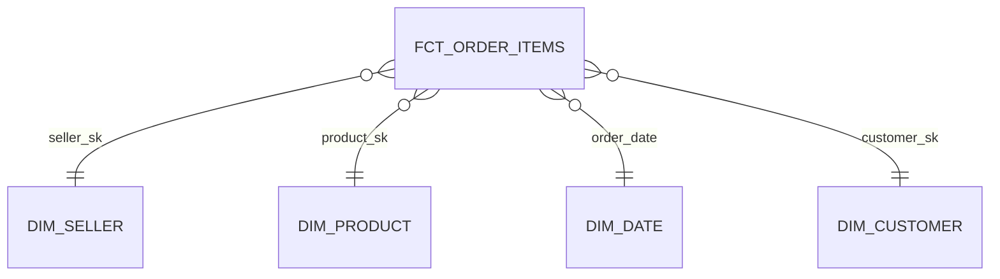

# Data Modeling and SCD2

> [!info] Learning goals
> After this note you can: design tables from business questions; declare the grain of a fact table; separate facts from dimensions in a star schema; choose natural vs surrogate keys; classify measures as additive, semi-additive or non-additive; implement slowly changing dimensions (SCD1 and SCD2) and join facts to the correct historical version; and explain how medallion layers relate to the model.

## 1. Why model at all

Raw source tables are shaped for the application that writes them (normalised, many joins, codes instead of names). Analysts need tables shaped for **questions**: "revenue per seller state per month", "late-delivery rate per category". Data modelling turns the first into the second so that:

- every metric is computed once, the same way, by everyone;
- queries are simple and fast (few joins, clear keys);
- history is preserved where the business needs it.

Start from the questions, not from the source tables. Write 5–10 concrete questions and the metrics they need before designing anything.

## 2. Layers: medallion and the model

| Layer | Also called | Content | Rules |
|---|---|---|---|
| Bronze / raw | landing, raw | Exactly what the source sent (often all text) | Append or snapshot; never edited; enables replay |
| Silver / staging | staging, cleaned | Typed, renamed, deduplicated, one row per source entity | 1:1 with source entities; no business aggregation |
| Gold / marts | marts, presentation | Facts and dimensions, metrics | Business logic, tested, documented, served to users |

Medallion is a way to organise **processing steps**. It does not replace the business model: the star schema lives in gold.

## 3. Star schema: facts and dimensions



- A **fact table** records events or measurements: one row per order item, per payment, per delivery. It holds **foreign keys** to dimensions and numeric **measures** (price, freight, quantity).
- A **dimension table** describes the context: who, what, where, when — seller, product, customer, date. It holds descriptive **attributes** (state, category, city) used to filter and group.

Star = one fact in the middle, dimensions around it, one join per dimension. A *snowflake* normalises dimensions further (product → category table); it saves little space and costs joins, so most marts stay star-shaped.

### Grain first

The **grain** is what one fact row represents, declared before choosing columns: "one row per order item" (`fct_order_items`) or "one row per order" (`fct_orders`). All measures in a fact must belong to that grain. Mixing grains — e.g. putting the order's total payment on every item row — causes double counting when summed ([[JOIN Grain and Fan-out]]).

Types of facts:

| Type | Grain | Example |
|---|---|---|
| Transaction | one event | an order item |
| Periodic snapshot | one entity per period | inventory per product per day |
| Accumulating snapshot | one process instance, updated as milestones happen | an order with purchase, approval, shipping, delivery timestamps |

`fct_orders` in Olist is close to an accumulating snapshot: one row per order with timestamps for each milestone.

## 4. Keys

| Key | Example | Notes |
|---|---|---|
| Natural (business) key | `seller_id` from the source | Meaningful, but can be reused, change format or collide across sources |
| Surrogate key | `seller_sk` = 1, 2, 3 or a hash | Owned by the warehouse; identifies one **version** of a dimension row in SCD2 |
| Composite key | `(order_id, order_item_id)` | Unique only together |

In dbt a common surrogate key is a hash of the natural key plus the version start (`dbt_utils.generate_surrogate_key`).

## 5. Measures and additivity

| Type | Can be summed across… | Examples | How to aggregate |
|---|---|---|---|
| Additive | all dimensions | revenue, freight, item count | `SUM` |
| Semi-additive | some dimensions, not time | account balance, stock level | sum across products, but take last/avg over time |
| Non-additive | nothing | ratios, percentages, averages, distinct counts | store numerator and denominator; compute the ratio after aggregating |

Classic error: averaging daily late-delivery percentages to get a monthly rate. Instead sum late orders and delivered orders for the month, then divide. Distinct counts are also non-additive: the number of customers per month is not the sum of customers per day.

## 6. Slowly changing dimensions

Dimension attributes change: a seller moves from SP to RJ. What should old orders show?

| Type | Behaviour | Use when |
|---|---|---|
| SCD0 | Never change | fixed attributes (birth date) |
| SCD1 | Overwrite; history lost | corrections, or when only the current value matters |
| SCD2 | Add a new row per version with a validity range | you must report facts with the attribute **as it was** at the time |
| SCD3 | Keep "previous value" column | rare; one level of history |

### SCD2 structure

| seller_sk | seller_id | state | valid_from | valid_to | is_current |
|---|---|---|---|---|---|
| 1 | s1 | SP | 2026-01-01 | 2026-02-01 | false |
| 2 | s1 | RJ | 2026-02-01 | 9999-12-31 | true |

Rules: for each natural key, ranges are **half-open** `[valid_from, valid_to)`, contiguous, and **never overlap**; exactly one row is current. A far-future date (or NULL) marks the open end.

### Joining facts to the right version

```sql
-- runnable
-- expect: [["o1", "SP"], ["o2", "RJ"]]
WITH seller_versions(seller_sk, seller_id, state, valid_from, valid_to) AS (
    VALUES (1,'s1','SP',DATE '2026-01-01',DATE '2026-02-01'),
           (2,'s1','RJ',DATE '2026-02-01',DATE '9999-12-31')
), orders(order_id, seller_id, order_date) AS (
    VALUES ('o1','s1',DATE '2026-01-31'), ('o2','s1',DATE '2026-02-01')
)
SELECT o.order_id, d.state
FROM orders o JOIN seller_versions d
  ON o.seller_id = d.seller_id
 AND o.order_date >= d.valid_from AND o.order_date < d.valid_to
ORDER BY o.order_id;
-- Expected: o1 SP; o2 RJ. Half-open ranges avoid matching two versions on the boundary day.
```

With a closed range (`<=` on both ends), an order on 2026-02-01 would match both versions and be duplicated. Alternatively, resolve the surrogate key once when loading the fact (`seller_sk` stored on the fact row), so queries need no range join.

### Testing SCD2

```sql
-- runnable
-- expect: [["s2", 3, 4]]
WITH dim(seller_sk, seller_id, valid_from, valid_to) AS (
    VALUES (1, 's1', DATE '2026-01-01', DATE '2026-02-01'),
           (2, 's1', DATE '2026-02-01', DATE '9999-12-31'),
           (3, 's2', DATE '2026-01-01', DATE '2026-03-01'),
           (4, 's2', DATE '2026-02-15', DATE '9999-12-31')   -- overlaps version 3
)
SELECT a.seller_id, a.seller_sk, b.seller_sk
FROM dim a JOIN dim b
  ON a.seller_id = b.seller_id AND a.seller_sk < b.seller_sk
 AND a.valid_from < b.valid_to AND b.valid_from < a.valid_to;   -- interval overlap test
```

Expect zero rows in production. Also test: one current row per natural key, no gaps between consecutive versions (`valid_to` of one equals `valid_from` of the next), and every fact matches exactly one version.

### Building SCD2 from snapshots

Each load compares the incoming snapshot to the current rows by natural key, using a hash of the tracked attributes. Changed keys: close the current row (`valid_to = load time`, `is_current = false`) and insert a new row. New keys: insert. Deleted keys: close the row (or flag it). dbt **snapshots** implement exactly this ([[dbt Models Tests and Incremental]]).

### Late-arriving data

- **Late fact:** an order arrives after the seller changed state — the range join still picks the version valid at the order date. 
- **Late dimension:** a fact references a seller not yet in the dimension. Use an "unknown" member (`seller_sk = -1`) and repair it later in a controlled update, rather than dropping the fact.

## 7. Applying it to Olist

- `customer_id` is a per-order customer id in this dataset; `customer_unique_id` represents the person (per the source documentation). Customer-level metrics must use `customer_unique_id`.
- `fct_orders` (order grain) differs from item-level and payment-level facts; build each from pre-aggregated parts.
- The Olist CSVs are **snapshots without change history**. To practise SCD2, generate versioned changes yourself; do not call the current snapshot a full history.
- Module 05 output: an ERD, the grain of each table, and metric definitions (numerator, denominator, NULL policy, timezone, recognition date) — see [[BI Metrics and Data Products]].

## 8. Common mistakes

| Mistake | Effect | Fix |
|---|---|---|
| Undeclared or mixed grain | Double counting | Write the grain sentence; test uniqueness |
| Joining the *current* dimension to old facts | History rewritten | SCD2 + range join or stored surrogate key |
| Overlapping SCD2 ranges | Fan-out | Overlap test, half-open ranges |
| Gaps between versions | Facts with no match | Contiguity test |
| Averaging ratios | Wrong rates | Sum numerator and denominator first |
| Modelling from source tables instead of questions | Marts nobody uses | Start from questions and metrics |

## 9. Exercises

1. Design a small warehouse for a coffee shop with two facts of different grain (sales line, daily stock snapshot). Draw the ERD and write each grain sentence.
2. Add a seller who changes state and an order exactly on the boundary date; prove each fact matches exactly one version.
3. Write the SQL that closes changed rows and inserts new versions given yesterday's dimension and today's snapshot.
4. When is SCD1 a better choice than SCD2?

> [!example]- Discussion for 4
> When old values are errors (a typo in a city name), when nobody needs historical attribution, or when the attribute changes so often that history would explode and is not used. SCD2 has real costs: bigger tables, range joins and more tests.

## 10. Review questions

> [!question]- What is the difference between a fact and a dimension?
> A fact records events/measurements at a declared grain with numeric measures and foreign keys; a dimension describes the context with attributes used to filter and group.

> [!question]- Why use half-open validity ranges?
> So consecutive versions share a boundary without both matching it; every timestamp belongs to exactly one version.

> [!question]- How do you compute a monthly late-delivery rate from daily data?
> Sum late orders and eligible orders over the month, then divide. Never average daily percentages.

> [!question]- Why do surrogate keys exist if the source already has ids?
> To identify individual versions of a dimension row (SCD2), to isolate the warehouse from source id changes or collisions, and to support unknown members.

Related: [[JOIN Grain and Fan-out]], [[Incremental CDC and Backfill]], [[BI Metrics and Data Products]], [[Module 05 - Data Modeling]]. Sources: [Kimball dimensional modelling techniques](https://www.kimballgroup.com/data-warehouse-business-intelligence-resources/kimball-techniques/dimensional-modeling-techniques/), [dbt snapshots](https://docs.getdbt.com/docs/build/snapshots).
