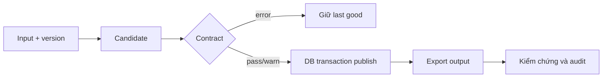

# Ingestion, Contract và Idempotency

## Khi dùng

Đưa dữ liệu nguồn vào hệ thống mà vẫn truy vết được, chặn cấu trúc hỏng và chạy lại an toàn. Contract gồm schema, key, giá trị hợp lệ, ý nghĩa, owner và chính sách thay đổi; YAML checks chỉ là một phần.

## Luồng tham chiếu



## Hash — Python chạy độc lập

```python
# runnable
import hashlib

a = b'order_id,amount\no1,100\n'
b = b'order_id,amount\no1,120\n'
history = {hashlib.sha256(a).hexdigest(), hashlib.sha256(b).hexdigest()}
current = hashlib.sha256(b).hexdigest()
incoming = hashlib.sha256(a).hexdigest()
assert incoming in history
assert incoming != current  # A -> B -> A phải publish A, không được skip.
```

## Quy tắc lỗi

Duplicate key hoặc cột bắt buộc mất: chặn publish. Đơn giao trễ hoặc hủy: sự thật nghiệp vụ, không tự xóa để “làm sạch”. Unknown status cần quyết định theo hợp đồng, không mặc định mọi trường hợp đều lỗi hoặc đều hợp lệ.

## Reference repo và giới hạn

`src/olist_platform/ingest.py` so hash của **bảng đang xuất bản**; audit manifest lưu lịch sử. Cùng input thì bỏ qua DB load nhưng vẫn export lại Parquet local để sửa missing/stale output. Đây là trade-off I/O phù hợp dataset nhỏ; ở scale lớn dùng versioned output + manifest/pointer và reconciliation.

DB và filesystem không chung transaction. Publish từng bảng không bảo đảm cả 9 nguồn là một snapshot nguyên tử; batch id/source version và quality gate trước serving vẫn cần thiết.

## Tự luyện bắt buộc

1. A→A không thêm load history; A→B→A ra A.
2. Contract fail giữ bảng cũ.
3. Xóa Parquet hoặc giữ file cũ sau DB commit, retry sửa được.
4. File rỗng có header: định nghĩa có cho phép không, test version khi không có dòng lineage.

Ôn: idempotent khác “đã từng thấy hash” thế nào? Có nên dựa mtime làm input version? Làm sao biết 9 bảng thuộc cùng lần xuất nguồn?

Liên quan: [[Files CSV JSON Parquet]], [[Observability va Recovery]]. Nguồn: [DuckDB transactions](https://duckdb.org/docs/stable/sql/statements/transactions.html).
