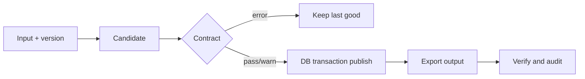

# Ingestion, Contracts and Idempotency

> [!info] Learning goals
> After this note you can: describe a robust ingestion flow from landing to publish; write a data contract (schema, keys, allowed values, meaning, owner, change policy); classify quality checks as blocking or warning; version inputs with hashes; make loads idempotent — including the A→B→A case; publish atomically and keep the last good version; and record lineage in an audit log.

## 1. What ingestion must guarantee

Ingestion brings source data into your platform. "It loaded without errors" is not enough. A good ingestion step guarantees:

1. **Traceability** — you can say exactly which input version produced each table.
2. **Protection** — broken input (missing columns, duplicate keys) never reaches consumers.
3. **Safe re-runs** — running the same load again, or retrying after a crash, does not duplicate or corrupt data (**idempotency**).
4. **Recoverability** — raw input is kept so any table can be rebuilt.

## 2. The reference flow



1. **Land** the raw file unchanged and compute its version (hash, size, row count).
2. Load it into a **candidate** (staging) table — never directly over the published table.
3. Run the **contract checks** on the candidate.
4. **Errors** → stop, keep the last good published version, alert. **Pass or warnings** → publish in a transaction.
5. **Export** derived outputs (Parquet) and **verify** them.
6. Write an **audit record**: run id, input version, counts, checks, status, duration.

## 3. Data contracts

A contract is an agreement between producer and consumer about the data. It covers more than a schema:

| Part | Example for `olist_orders` |
|---|---|
| Schema | columns `order_id`, `customer_id`, `order_status`, `order_purchase_timestamp`, … with types |
| Keys | `order_id` unique and not null |
| Allowed values | `order_status` ∈ {created, approved, invoiced, processing, shipped, delivered, canceled, unavailable} |
| Semantics | timestamps are São Paulo local time without zone (assumption to validate) |
| Freshness / volume | new snapshot at least monthly; row count within ±20% of previous |
| Owner and change policy | who to contact; schema changes announced N days ahead; additive changes allowed |

Contracts can be expressed as YAML checks, dbt tests, Great Expectations / Soda suites or plain SQL — the tool is secondary. What matters is that they are explicit, versioned with the code and enforced automatically.

### Blocking vs warning

| Finding | Severity | Why |
|---|---|---|
| Required column missing / renamed | **Block** | Downstream logic would be wrong or fail |
| Duplicate primary key | **Block** | Fan-out and double counting |
| Unparseable dates above threshold | **Block** or quarantine | Depends on the contract's reject budget |
| Unknown status value | Decide in the contract | New legitimate status vs bad data |
| Late or cancelled orders | **Not an error** | Business facts — never "clean" them away |
| Row count dropped 40% | Warn or block | Could be a partial export |

Write down the reason for each severity; "block everything" stops the business, "warn on everything" trains people to ignore alerts.

### A minimal contract check in Python

```python
# runnable
import pandas as pd

CONTRACT = {
    "required": ["order_id", "order_status"],
    "unique": ["order_id"],
    "allowed": {"order_status": {"delivered", "shipped", "canceled"}},
}

def check(df: pd.DataFrame, contract: dict) -> tuple[list[str], list[str]]:
    errors, warnings = [], []
    missing = [c for c in contract["required"] if c not in df.columns]
    if missing:
        return [f"missing columns {missing}"], warnings
    for col in contract["unique"]:
        dupes = int(df[col].duplicated().sum())
        if dupes:
            errors.append(f"{dupes} duplicate {col}")
    for col, allowed in contract["allowed"].items():
        unknown = sorted(set(df[col].dropna()) - allowed)
        if unknown:
            warnings.append(f"unknown {col}: {unknown}")
    return errors, warnings

good = pd.DataFrame({"order_id": ["o1", "o2"], "order_status": ["delivered", "lost"]})
bad = pd.DataFrame({"order_id": ["o1", "o1"], "order_status": ["delivered", "shipped"]})
assert check(good, CONTRACT) == ([], ["unknown order_status: ['lost']"])
assert check(bad, CONTRACT)[0] == ["1 duplicate order_id"]
assert check(pd.DataFrame({"order_id": []}), CONTRACT)[0] == ["missing columns ['order_status']"]
```

## 4. Input versions

You need to know whether an input is new. Options:

| Version signal | Reliability |
|---|---|
| File modification time (`mtime`) | Weak: copying or touching changes it; identical content looks new |
| File name with date | Depends on the producer's discipline |
| Content hash (SHA-256 of bytes) | Strong for "same bytes"; any byte change (even newline style) gives a new version |
| Source-provided version / export id | Best when available |

Record the version of **every** input in the audit table so any output can be traced back.

## 5. Idempotency and the A→B→A trap

A load is idempotent if running it again with the same input leaves the same result. The naive implementation — "skip if I have ever seen this hash" — is wrong:

```python
# runnable
import hashlib

a = b'order_id,amount\no1,100\n'
b = b'order_id,amount\no1,120\n'
history = {hashlib.sha256(a).hexdigest(), hashlib.sha256(b).hexdigest()}
current = hashlib.sha256(b).hexdigest()
incoming = hashlib.sha256(a).hexdigest()
assert incoming in history
assert incoming != current  # A -> B -> A must publish A, not skip it.
```

The source sent A, then B (a bad export), then corrected back to A. "Seen before" would skip the final A and leave the wrong B published. The correct rule: **skip only if the incoming version equals the version currently published.** Keep the full history in the audit log for lineage, but decide on the current pointer.

Other idempotency techniques:

- **Replace by partition/key** instead of appending (`DELETE` the partition + `INSERT`, or `MERGE` by key) — see [[CTE Dedup and Incremental SQL]].
- **Deterministic outputs**: the same input and code produce byte-identical (or at least equal) outputs, with no dependence on the current time.
- **Run ids and batch ids** stored with the data so a partial batch can be identified and removed.

## 6. Publishing safely

- Load into a candidate table, validate, then swap/replace the published table **inside a transaction**, so readers see either the old or the new version.
- The database and the filesystem do **not** share a transaction. If the DB commit succeeds and the Parquet export then fails (or leaves a stale file), the next retry must repair the output even though the DB already has the data. The reference implementation re-exports local Parquet even when it skips the DB load — a simple I/O trade-off that suits a small dataset. At scale you would write versioned outputs plus a manifest/pointer and reconcile.
- Publishing 9 tables one at a time does not make them one atomic snapshot. Use a batch id / source version on every table and a quality gate before serving, or publish all tables in one transaction.

## 7. Audit and lineage

```sql
CREATE TABLE audit.load_runs (
    run_id        VARCHAR PRIMARY KEY,
    source_table  VARCHAR,
    input_sha256  VARCHAR,
    rows_read     BIGINT,
    rows_published BIGINT,
    rows_rejected BIGINT,
    check_errors  VARCHAR,
    status        VARCHAR,     -- published | skipped_same_version | blocked | failed
    started_at    TIMESTAMP,
    finished_at   TIMESTAMP
);
```

Every run writes a row — including skipped and blocked runs. This table answers "what is published right now, since when, from which input?" and feeds freshness checks ([[Observability and Recovery]]).

## 8. Applying it to Olist

`src/olist_platform/ingest.py` in the code repo compares the hash with the **currently published** table, keeps history in an audit manifest, blocks on contract errors and keeps the last good table. In lab 06 you write your own version (`labs/06-ingest/my_ingest.py`) driven by the tests.

Mandatory drills:

1. A→A adds no new load; A→B→A ends with A published.
2. A contract failure keeps the previous table.
3. Delete the Parquet output (or leave a stale one) after the DB commit; a retry repairs it.
4. An empty file with only a header: decide whether it is allowed and test the version recorded when there are no rows.

## 9. Common mistakes

| Mistake | Effect | Fix |
|---|---|---|
| "Skip if hash ever seen" | A→B→A stuck at B | Compare with the currently published version |
| Loading straight into the published table | Readers see partial data; no last good | Candidate + transactional swap |
| Deleting late/cancelled orders as "dirty" | Wrong business metrics | Only remove what the contract defines as invalid |
| `mtime` as version | False "new" inputs, missed real changes | Content hash or source version |
| Assuming DB commit implies outputs exist | Missing/stale files | Verify and repair on every run |
| No audit for skipped/blocked runs | Cannot explain current state | Audit every run |

## 10. Exercises

1. Implement `should_load(incoming_hash, published_hash)` and test A→A, A→B, A→B→A.
2. Extend the contract check with a row-count rule: warn if the count changes more than 20% from the last published run.
3. Simulate a crash between DB commit and export; write the recovery logic and a test for it.
4. How would you prove that the 9 Olist tables belong to the same source export?

> [!example]- Discussion for 4
> Ideally the source provides an export id or manifest listing all files with hashes. Without it, check referential consistency (every item's order exists, date ranges align) and record all 9 hashes under one batch id; publish only when the batch is complete.

## 11. Review questions

> [!question]- How is idempotency different from "I have seen this hash before"?
> Idempotency means re-running yields the same final state. "Seen before" ignores the order of versions and fails the A→B→A case; the right comparison is against what is currently published.

> [!question]- Should you use `mtime` as the input version?
> No. It changes without content changes and can stay the same across real changes. Use a content hash or a source-provided version.

> [!question]- Why keep the last good version on a contract failure?
> Consumers keep correct (if slightly older) data, and the failure is visible through the audit/alert instead of corrupting dashboards.

> [!question]- Why does a successful DB transaction not guarantee correct Parquet outputs?
> The file write is outside the transaction; it can fail or leave stale content after the commit, so each run must verify and repair outputs.

Related: [[Files CSV JSON and Parquet]], [[Observability and Recovery]], [[Testing Logging and CI]], [[Module 06 - Ingestion and Quality]]. Sources: [DuckDB transactions](https://duckdb.org/docs/stable/sql/statements/transactions.html), [Open Data Contract Standard](https://bitol-io.github.io/open-data-contract-standard/).
