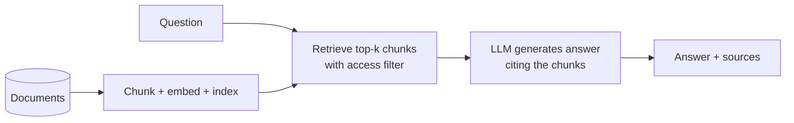

# RAG: Retrieval and Evaluation

> [!info] Learning goals
> After this note you can: explain retrieval-augmented generation end to end; ingest documents with ids, hashes and versions; chunk with sensible sizes and metadata; compare lexical and embedding retrieval; evaluate retrieval (recall@k, MRR) separately from generation (groundedness, citations, refusals); enforce permissions at retrieval time; and keep the index fresh when documents change or are deleted.

## 1. What RAG is

**Retrieval-augmented generation** answers questions from your documents instead of the model's memory:



Benefits: answers can cite sources, and you update knowledge by updating documents — no retraining. A vector database alone does not make answers trustworthy; RAG is a **data pipeline** (ingestion, versioning, indexing) plus evaluation.

## 2. Ingestion and chunking

Pipeline: document id + content hash + version → chunks with source/heading metadata → embeddings (with the embedding model version) → index → retrieval with access filters → answer with citations.

Chunking choices:

- **Size:** a few hundred tokens with some overlap is a common start. Too large: retrieval returns noise; too small: chunks lose context.
- **Structure-aware:** split on headings/sections (Markdown headings in this vault) so each chunk is coherent; keep the heading path as metadata.
- **Metadata:** `doc_id`, `version`, `heading`, `updated_at`, `access_group` — needed for citations, freshness and permissions.

```python
# runnable
import hashlib
import re

note = """# JOIN Grain and Fan-out
Intro text.
## Fan-out
Two 1:n joins multiply rows.
## The fix
Aggregate to the target grain first."""

def chunk_by_heading(doc_id: str, text: str) -> list[dict]:
    parts = re.split(r"(?m)^(?=## )", text)
    chunks = []
    for part in parts:
        heading = part.splitlines()[0].lstrip("# ").strip()
        chunks.append({"doc_id": doc_id, "heading": heading, "text": part.strip(),
                       "hash": hashlib.sha256(part.encode()).hexdigest()[:12]})
    return chunks

chunks = chunk_by_heading("join-note", note)
assert [c["heading"] for c in chunks] == ["JOIN Grain and Fan-out", "Fan-out", "The fix"]
```

## 3. Retrieval methods

| Method | How | Strengths | Weaknesses |
|---|---|---|---|
| Lexical (BM25, keyword) | term overlap weighted by rarity | exact terms, codes, names; no model needed | misses synonyms/paraphrases |
| Dense (embeddings) | nearest vectors in embedding space | meaning, paraphrases, other languages | can miss exact identifiers; needs a model and versioning |
| Hybrid | combine both scores | robust | more tuning |
| Reranking | a cross-encoder re-scores top candidates | better precision | latency/cost |

Always keep a cheap baseline:

```python
# runnable
docs = {
    'grain': 'fact orders one row per order',
    'timezone': 'timestamps utc local business date',
    'retry': 'api timeout backoff retry',
}
query = set('orders grain order'.split())
scores = {key: len(query & set(text.split())) for key, text in docs.items()}
ranked = sorted(scores, key=lambda key: (-scores[key], key))
assert ranked[0] == 'grain'
gold = {'grain'}
recall_at_1 = len(set(ranked[:1]) & gold) / len(gold)
assert recall_at_1 == 1.0
```

This is a token-overlap baseline, not embeddings or full RAG. It gives you an independent retrieval measurement before adding complex models.

## 4. Evaluate retrieval and generation separately

If the answer is wrong, was the right chunk not retrieved, or did the model ignore/misuse it? Measure the layers separately.

**Retrieval** — a question set with gold chunks:

```python
# runnable
def recall_at_k(ranked: list[str], gold: set[str], k: int) -> float:
    return len(set(ranked[:k]) & gold) / len(gold)

def reciprocal_rank(ranked: list[str], gold: set[str]) -> float:
    for position, doc in enumerate(ranked, start=1):
        if doc in gold:
            return 1 / position
    return 0.0

runs = [(["a", "b", "c"], {"b"}), (["x", "y", "z"], {"q"}), (["m", "n"], {"m"})]
mean_recall_at_2 = sum(recall_at_k(r, g, 2) for r, g in runs) / len(runs)
mrr = sum(reciprocal_rank(r, g) for r, g in runs) / len(runs)
assert round(mean_recall_at_2, 3) == 0.667
assert round(mrr, 3) == 0.5                 # (1/2 + 0 + 1) / 3
```

**Generation:**

- **Groundedness/faithfulness:** every claim is supported by the retrieved chunks.
- **Citation correctness:** the cited chunk actually supports the claim (a citation to an existing file can still be irrelevant).
- **Refusal:** when evidence is missing, the system says so instead of inventing.
- Graded by humans on a sample, possibly assisted by an LLM judge that you validate against human grades.

**Permissions:** users must never retrieve chunks they cannot access — filter at retrieval time, not after generating an answer.

**Operations:** document version and last index time, query latency, cost.

## 5. Freshness and deletion

Documents change and get deleted. The index must follow:

- Re-chunk and re-embed a document when its content hash changes; delete its old chunks.
- Remove chunks of deleted documents (and respect deletion requests for personal data).
- Re-embed everything when the embedding model changes — vectors from different models are not comparable.
- Invalidate cached answers that used changed chunks.

This is the same incremental/CDC problem as in [[Incremental CDC and Backfill]], applied to text.

## 6. Applying it (optional extension)

Index this DEcourse vault, write 20 questions with expected source chunks, split dev/test. Compare the lexical baseline with embeddings on the same set (recall@k, MRR). Then change a grain definition and delete a note: prove answers no longer use the old chunks.

## 7. Common mistakes

| Mistake | Effect | Fix |
|---|---|---|
| Evaluating only final answers | Cannot locate failures | Separate retrieval and generation metrics |
| No document versions | Stale or deleted content answered | Hashes, versions, deletion handling |
| Mixing embedding model versions | Garbage similarity | Version embeddings; re-embed on change |
| Permission filtering after generation | Data leaks into answers | Filter at retrieval |
| Trusting "correct" answers | May come from model memory, not retrieval | Check retrieved chunks and citations |

## 8. Exercises

1. Chunk five vault notes by heading and store `doc_id`, heading and hash.
2. Write 20 questions with gold chunks; compute recall@3 and MRR for the lexical baseline.
3. Add embeddings and compare on the same test set.
4. Edit one note and delete another; show the index and answers update.

## 9. Review questions

> [!question]- Does a correct answer prove retrieval worked?
> No. The model may answer from its own training knowledge; check whether the retrieved chunks actually contain the supporting evidence.

> [!question]- Why can a citation to an existing file still be wrong?
> The file exists but the cited passage may not support the claim; citations must be checked for support, not existence.

> [!question]- Why must permissions be enforced during retrieval?
> Once a restricted chunk is in the prompt, its content can appear in the answer; filtering afterwards is too late.

> [!question]- What must happen when the embedding model changes?
> All chunks must be re-embedded with the new model and the index rebuilt, because vectors from different models are not comparable.

Related: [[LLM Caching Evaluation and Guardrails]], [[Ingestion Contracts and Idempotency]], [[Module 16 - LLM]]. Sources: [Lewis et al., Retrieval-Augmented Generation (2020)](https://arxiv.org/abs/2005.11401), [OWASP Top 10 for LLM applications](https://genai.owasp.org/llm-top-10/).
