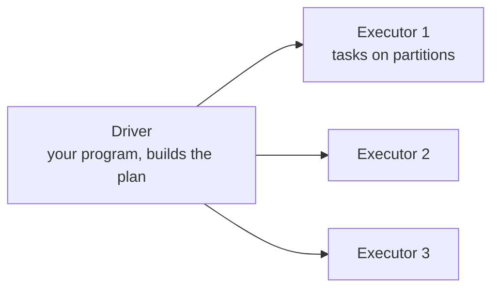

# Spark: Partitions, Shuffle and Skew

> [!info] Learning goals
> After this note you can: explain Spark's architecture (driver, executors, tasks, stages); distinguish lazy transformations from actions; tell narrow from wide transformations and recognise shuffles in a plan; size partitions; detect and fix data skew; choose broadcast joins; avoid Python UDF and `collect()` traps; and design an honest Spark experiment.

## 1. When Spark is the right tool

Spark distributes computation across many cores and machines. It is worth it when data or processing exceeds one machine, or when the company platform is built on it (Databricks, EMR, Dataproc). For Olist (100k orders), DuckDB is the baseline and will usually be faster; use Spark here to learn distributed concepts, judged by semantics, plans and scale experiments — never by the promise that it is always faster.

## 2. Architecture



- **Driver:** runs your code, builds the logical plan, schedules work. Results of `collect()` land here.
- **Executors:** JVM processes on workers that run **tasks**, one task per **partition** of data.
- **Job → stages → tasks:** an action creates a job; Spark splits it into stages at shuffle boundaries; each stage runs one task per partition.
- `local[2]` runs everything in one process with 2 threads — good for learning.

## 3. Lazy evaluation

**Transformations** (`select`, `filter`, `withColumn`, `join`, `groupBy`) only build a plan. **Actions** (`count`, `collect`, `show`, `write`) trigger execution. The Catalyst optimiser rewrites the whole plan before running: it pushes filters down, prunes columns and picks join strategies.

```python
# Standalone pattern after installing Spark/Java; on Windows use WSL for this lab.
from pyspark.sql import SparkSession, functions as F
spark = SparkSession.builder.master('local[2]').appName('shuffle-lab').getOrCreate()
try:
    df = spark.createDataFrame([('SP',100),('SP',50),('RJ',20)], ['state','amount'])
    result = df.groupBy('state').agg(F.sum('amount').alias('total'))
    result.explain(True)                         # parsed, analysed, optimised and physical plans
    assert {r['state']: r['total'] for r in result.collect()} == {'SP':150,'RJ':20}
finally:
    spark.stop()
```

## 4. Narrow vs wide transformations and shuffles

- **Narrow:** each output partition depends on one input partition (`filter`, `select`, `withColumn`). No data movement.
- **Wide:** output partitions need data from many input partitions (`groupBy`, `join`, `distinct`, `orderBy`, window functions). Spark must **shuffle**: every task writes its rows bucketed by key to disk, and the next stage's tasks fetch their bucket over the network.

In the physical plan a shuffle appears as `Exchange hashpartitioning(state, 200)`. Shuffles are usually the most expensive part of a job: disk writes, network, serialisation.

The idea of a shuffle can be simulated in plain Python:

```python
# runnable
from collections import defaultdict

partitions = [[("SP", 100), ("RJ", 20)], [("SP", 50), ("MG", 5)]]   # data on two executors
NUM_REDUCERS = 2
buckets = [defaultdict(list) for _ in range(NUM_REDUCERS)]
for part in partitions:                       # map side: route each row by key hash
    for key, value in part:
        buckets[sum(map(ord, key)) % NUM_REDUCERS][key].append(value)
totals = {key: sum(values) for bucket in buckets for key, values in bucket.items()}
assert totals == {"SP": 150, "RJ": 20, "MG": 5}
# All rows of one key always meet in the same reducer: that is why a hot key overloads one task.
```

`spark.sql.shuffle.partitions` (default 200) sets the number of post-shuffle partitions. Adaptive Query Execution (AQE, on by default in Spark 3.2+) can coalesce small shuffle partitions and split skewed ones at run time — check the final plan, not just the config.

## 5. Partition sizing

| Tool | Does | Watch |
|---|---|---|
| `repartition(n)` / `repartition("col")` | Full shuffle to n partitions / by key | Shuffle cost; file count on write |
| `coalesce(n)` | Merges partitions without a full shuffle | Can create imbalanced, fewer tasks |
| `partitionBy("col")` on write | One folder per value | High cardinality → small files |

Rules of thumb: ~100–200 MB per partition in memory; at least 2–3 tasks per core; avoid thousands of tiny partitions. Never partition output by `order_id` — one file per order.

## 6. Skew

**Skew** means some keys have far more rows than others. All rows of a key go to one task, so one task runs for an hour while 199 finish in a minute — the stage takes an hour. In the Spark UI, look at the task duration and shuffle-read distribution: max ≫ median means skew.

Fixes:

1. **Broadcast join** if the other side is small (see below) — no shuffle of the big side.
2. **AQE skew join** (`spark.sql.adaptive.skewJoin.enabled`) splits large partitions automatically for joins.
3. **Salting:** add a random suffix `key_0…key_9` on the big side, replicate the small side ten times, join, then aggregate back.
4. **Handle hot keys separately** (e.g., NULL or "unknown" keys often are the hot ones — filter them out first).

## 7. Joins

| Strategy | When | Cost |
|---|---|---|
| Broadcast hash join | One side small (default threshold 10 MB, configurable) | Copies small table to every executor; no shuffle of the big table |
| Sort-merge join | Both sides large | Shuffle and sort both sides |
| Shuffle hash join | Medium sizes | Shuffle both, hash one |

`F.broadcast(dim_df)` hints a broadcast. A "small" dimension that is actually large can exhaust executor memory — measure its real size.

## 8. Traps

- **`collect()` on a large DataFrame** pulls everything into the driver and can crash it. Use `show`, `take`, `limit`, or write the result.
- **Python UDFs** serialise rows between the JVM and Python and block optimisation. Prefer built-in functions (`F.when`, `F.regexp_extract`, `F.date_trunc`); if needed, pandas UDFs (Arrow, vectorised). Benchmarks comparing a Python UDF with a native expression measure the UDF, not Spark.
- **Caching everything** wastes memory; cache only DataFrames reused several times, and unpersist them.
- **Version compatibility:** Java, Spark, PySpark, Delta/Iceberg versions must match; record them.

## 9. Table formats

Delta Lake, Apache Iceberg and Hudi add a transaction log on top of Parquet files: atomic commits, snapshots/time travel, schema evolution, `MERGE`, and compaction. They make data-lake tables behave more like warehouse tables. Check compatibility and the semantics of concurrent commits before relying on them.

## 10. Applying it (Spark branch)

RFM per customer with the same result as DuckDB (fixed reference date, explicit tie handling). Generate 1M+ records with distinct IDs and deliberate key skew sized to your RAM, keeping the seed and semantics. Compare plans and task times before/after a broadcast or skew fix. Count files before/after partitioning.

## 11. Common mistakes

| Mistake | Effect | Fix |
|---|---|---|
| Assuming Spark beats DuckDB on small data | Slower, more complex | Benchmark honestly; scale up first |
| Ignoring the plan | Hidden shuffles | `explain()`, Spark UI |
| Partitioning output by high-cardinality key | Millions of files | Date partitions, compaction |
| `collect()` on big data | Driver out of memory | Write or aggregate first |
| Python UDFs for simple logic | Slow, unoptimised | Built-in functions |
| Duplicating IDs to "scale" data | Artificial skew, broken keys | Generate realistic distinct keys |

## 12. Exercises

1. Run the groupBy example, find the `Exchange` in the physical plan and explain it.
2. Create a dataset where one state has 90% of rows; observe task imbalance in the UI; fix with AQE or salting and compare.
3. Join a 1M-row fact to a 30-row dimension with and without `broadcast`; compare plans and times.
4. Reproduce the RFM result in DuckDB and Spark and assert equality.

## 13. Review questions

> [!question]- Why can `collect()` on a whole table crash the driver?
> It transfers every row from executors into the single driver process's memory.

> [!question]- Do 100k orders prove distributed scale?
> No. They fit in one machine's memory; they show functional correctness only.

> [!question]- What causes a shuffle?
> Wide transformations — joins, groupBy, distinct, sorts, windows — that need rows with the same key on the same task.

> [!question]- How do you recognise skew?
> In the Spark UI, a few tasks in a stage take much longer and read far more shuffle data than the median.

Related: [[Performance and Storage]], [[DataFrames pandas and Polars]], [[Module 12 - Spark]]. Sources: [Spark SQL guide](https://spark.apache.org/docs/latest/sql-programming-guide.html), [Spark SQL performance tuning](https://spark.apache.org/docs/latest/sql-performance-tuning.html), [Spark web UI](https://spark.apache.org/docs/latest/web-ui.html).
