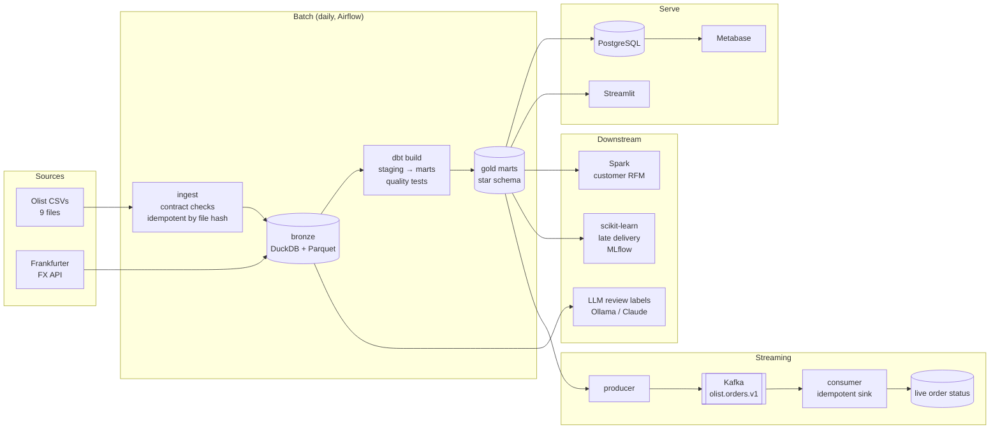

# Olist Data Platform

## Học và ôn tập với DEcourse

- [Lộ trình hướng sản phẩm](learning/README.md): core bắt buộc, một nhánh tự chọn, dữ liệu thật từ module dbt, bài vận hành và dự án độc lập.
- [DEcourse — vault Obsidian tiếng Việt](DEcourse/README.md): syntax, code có expected output, tình huống áp dụng, bẫy, bài tập và lịch ôn 1–7–30 ngày. Mở thư mục `DEcourse` bằng **Open folder as vault**, bắt đầu tại `00 - Bat dau/DEcourse.md`.
- [Production modules 19–22](learning/phase-7-production/19-incremental-cdc.md): incremental/CDC, observability/recovery, security/delivery và chuyển kiến thức sang domain mới.

Validate vault links and local executable examples with `python scripts/check_course.py` after installing the core dependencies. CI runs the same check; service/cloud patterns are excluded from automatic execution.

The platform below is a reference implementation. Your learning progress is tracked separately in the vault; written integrations and sample tests do not prove every service has been operated on real data.

An end-to-end data platform on real e-commerce data: ~100k orders from Olist, a Brazilian
marketplace. Raw CSVs and an exchange-rate API go in; a tested star schema, a streaming order
feed, a late-delivery model and LLM-labelled customer reviews come out.

Built as a learning project to practise what a data engineering team runs in production:
contracts at ingestion, idempotent loads, dbt models with reconciliation tests, orchestration,
streaming with at-least-once delivery, and treating ML/LLM output as data that must be validated.

[](https://github.com/quanw12/courseDE/actions/workflows/ci.yml)

## Architecture



## Stack

| Layer | Tool | Where |
|---|---|---|
| Language | Python 3.12, SQL | [`src/olist_platform`](src/olist_platform) |
| Ingestion + data quality | DuckDB, YAML data contracts | [`ingest.py`](src/olist_platform/ingest.py), [`quality.py`](src/olist_platform/quality.py), [`contracts/olist.yml`](src/olist_platform/contracts/olist.yml) |
| API extraction | requests, retry with backoff | [`fx.py`](src/olist_platform/fx.py) |
| Lake / warehouse | Parquet, DuckDB (local) · BigQuery + GCS (cloud) | `data/lake`, [`infra/terraform/gcp`](infra/terraform/gcp) |
| Transformation | dbt (staging → intermediate → marts, incremental) | [`dbt/`](dbt) |
| Orchestration | Apache Airflow 3 | [`orchestration/dags/olist_daily.py`](orchestration/dags/olist_daily.py) |
| Distributed processing | Apache Spark (PySpark) | [`spark/customer_rfm.py`](spark/customer_rfm.py) |
| Streaming | Apache Kafka (KRaft) | [`streaming.py`](src/olist_platform/streaming.py) |
| Serving + BI | PostgreSQL, Metabase, Streamlit | [`serve.py`](src/olist_platform/serve.py), [`dashboards/app.py`](dashboards/app.py) |
| ML | scikit-learn, MLflow | [`ml.py`](src/olist_platform/ml.py) |
| LLM | Ollama (local), Claude API, structured output + eval | [`ai_enrich.py`](src/olist_platform/ai_enrich.py) |
| Infra / CI | Docker Compose, Terraform, GitHub Actions, pytest, ruff | [`docker-compose.yml`](docker-compose.yml), [`.github/workflows/ci.yml`](.github/workflows/ci.yml) |

## Quick start (5 minutes, no downloads)

Runs the whole batch on a generated sample with the same files and quirks as the real dataset.

```powershell
py -3.12 -m venv .venv
.venv\Scripts\Activate.ps1
python -m pip install -e ".[dev,dbt,ml]"

olist sample --orders 5000      # synthetic Olist-shaped CSVs -> data/landing/olist
olist run --offline             # ingest -> fx (offline rates) -> dbt build -> gold Parquet
olist ml-train                  # late-delivery model, tracked in MLflow
olist ai-label --provider keyword
olist ai-eval
pytest
```

## Run on the real dataset

1. Download [Brazilian E-Commerce Public Dataset by Olist](https://www.kaggle.com/datasets/olistbr/brazilian-ecommerce) (free Kaggle account) and unzip the CSVs into `data/landing/olist/`.
2. `olist run` (live FX API) — re-running is safe: unchanged files are skipped by hash.
3. Optional services: `docker compose up -d postgres metabase` then `olist serve`; `docker compose up -d kafka` then `olist stream-produce` / `olist stream-consume`; `docker compose up -d airflow`.

## What the data taught me

Details and counts in [docs/data-contract.md](docs/data-contract.md). The short version:

- **Grain decides everything.** Items are one row per item, payments one row per payment. Joining both to orders repeats each payment once per item. Both are summed to the order first, and a dbt test reconciles every cent against the source.
- **Timestamps have no zone.** This project assumes São Paulo wall-clock time; record and validate that assumption against the source, including historical summer time. Staging stores UTC for durations and the local date as the business day.
- **Reject broken data, keep bad news.** A late or cancelled order is a fact; a duplicate key is broken. Contract checks stop the load only for the second kind.
- **Revenue has two definitions.** Payments and item prices can differ; measure the gap and investigate unmatched orders and payment semantics before assigning causes. Every report states which one it uses.
- **LLM output is untrusted input.** Labels are schema-validated, cached per prompt version and scored against the customer's own rating before anyone uses them.

## Repository layout

```text
src/olist_platform/   pipeline package and the `olist` CLI
dbt/                  dbt project: staging, intermediate, marts, tests
orchestration/        Airflow DAG and image
spark/                PySpark jobs
dashboards/           Streamlit app
infra/terraform/      GCP lake + warehouse as code
tests/                pytest: unit tests and an end-to-end dbt run on the sample
docs/                 architecture, data contract, decisions, runbook, AI log
learning/             32-week core + elective roadmap: 22 modules, production drills, independent project
DEcourse/             standalone Obsidian vault: Vietnamese syntax, examples, applications and review
labs/                 your own code for the learning path, with tests that start red
```

## Status

| Part | State |
|---|---|
| Ingest, contracts, FX, dbt marts, gold export | Done, tested in CI on the sample |
| ML model + MLflow, LLM labels (keyword baseline) | Done, tested on the sample |
| Kafka streaming | Logic unit-tested; end-to-end run with the broker: _to do_ |
| Airflow DAG, Postgres + Metabase, Spark job, Terraform | Written; run and record results: _to do_ |
| Results on the full real dataset | _to do_ — fill in [docs/data-contract.md](docs/data-contract.md) |

Regression coverage includes snapshot A→B→A, repairing missing/stale bronze Parquet on retry,
and invalidating LLM labels when review text or model changes. Bronze snapshots are re-exported
even when the DB load is skipped; this trades local I/O for recoverable outputs on this small dataset.
The daily incremental mart still has a bounded lookback; historical updates/deletes require an
explicit rebuild/backfill policy (learning module 19). The reference Airflow DAG schedules snapshots;
interval-aware processing is a learner extension, not an implemented CLI feature.

## Credits

- Data: Olist, *Brazilian E-Commerce Public Dataset by Olist*, Kaggle, CC BY-NC-ND 4.0. The dataset is not redistributed here; tests use a synthetic sample.
- Exchange rates: [Frankfurter](https://frankfurter.dev/).
- The reconcile-to-the-cent check and the FX gap rule were inspired by a classmate's Olist pipeline ([ndgthuan/olist](https://github.com/ndgthuan/olist)); the implementation here is separate (SQL/dbt instead of pandas).
